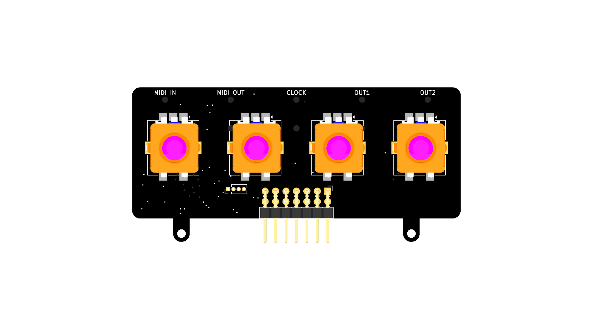
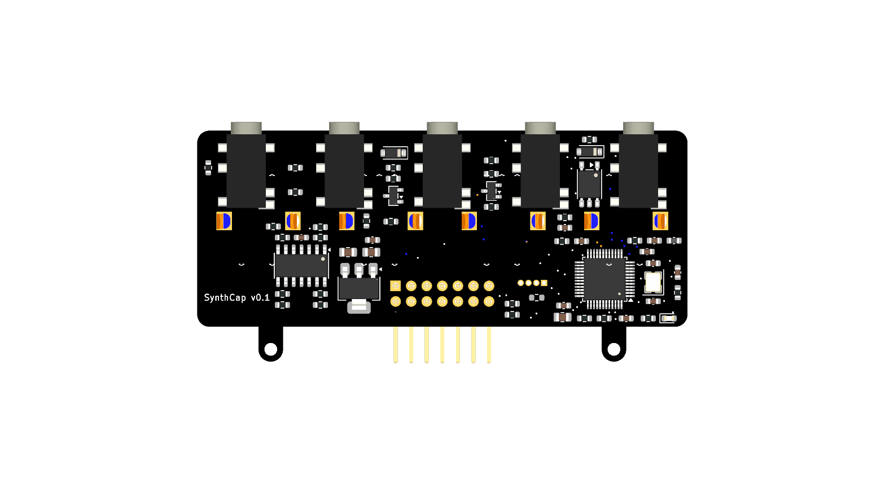
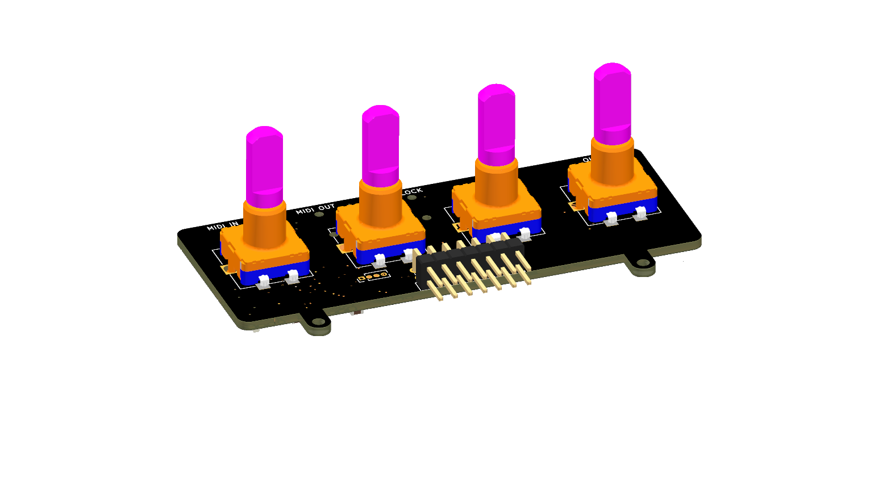
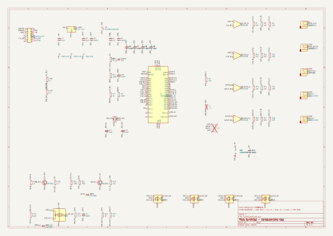

# SynthCap

A MIDI / CV interface "Cap" for the M5Stack CardputerZero. It plugs into the EXT 2.54-14P header. Designed in KiCad 10.

| Front (encoders) | Back (jacks and SMD parts) |
|---|---|
|  |  |

**Status: work in progress.** The board has been auto-routed but never built. Nothing here is tested on hardware.

## Features
- MCU: CH32V303CBT6, connected to the CardputerZero as a USB MIDI device (EXT pins 1 and 3)
- MIDI IN / OUT on 3.5mm TRS (Type A)
- 2 x CV out (0-5V, internal DAC + LMV324) and 2 x Gate out
- Clock in / out
- 4 x rotary encoder with push switch (Alps EC12E)
- 80 x 32mm, 2 layers. All SMD parts are on the back, for single-side assembly at JLCPCB
- Firmware upload is meant to work from the CardputerZero alone, over the chip's USB ISP bootloader (`wchisp`)

## Schematic
[Schematic (PDF)](docs/schematic.pdf)

## Folders
| Path | Contents |
|---|---|
| `SynthCap.kicad_*` | KiCad project |
| `SynthCap.pretty/`, `SynthCap.3dshapes/` | Project footprints and 3D models |
| `tools/` | Scripts that generate the schematic, footprints and board. `tools/design.py` is the single source for the circuit |
| `jlcpcb/` | BOM and CPL for JLCPCB assembly |
| `shell/` | 3D-printed shell (OpenSCAD) |
| `docs/` | Schematic and renders |
| `memos/` | Design notes (Japanese) |

## Not included
- The PJ-342 jack datasheet (LCSC part C668606). The footprint was drawn from its land pattern drawing.
- The Alps EC11E STEP model. To see the encoders in the 3D viewer, put `EC11E-05SW.STEP` in `SynthCap.3dshapes/`.

## Known open points
- The Tip / Ring pin mapping of the PJ-342 jack is read from the drawing and not confirmed on a real part.
- The encoder footprint uses SMD pads for a through-hole part (legs are bent or cut and soldered on the surface).
- The position of the mounting ear holes against the CardputerZero screw points is estimated from drawings.

## Warning
`tools/gen_pcb.py` rebuilds the board from scratch and removes all routing. Do not run it on a routed board.
